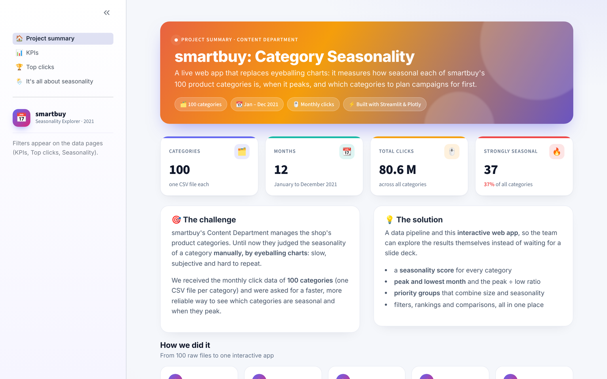
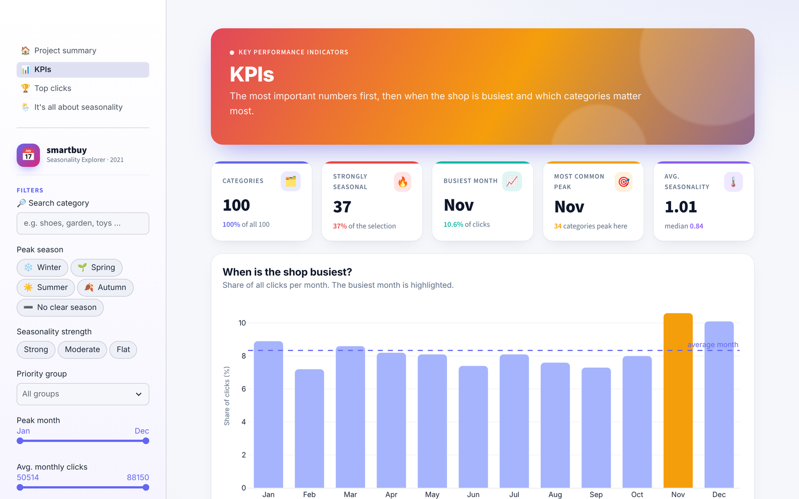
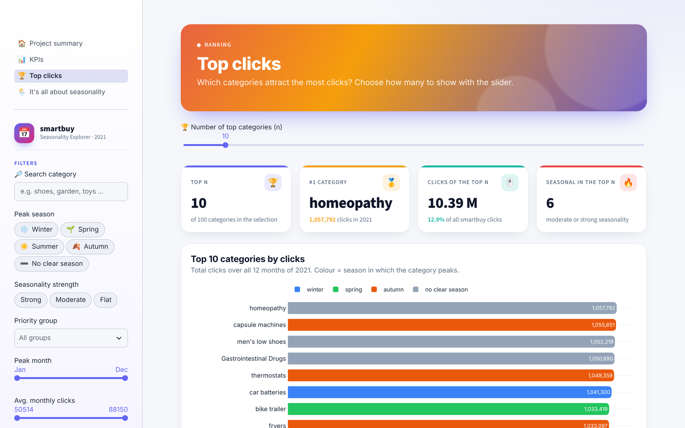
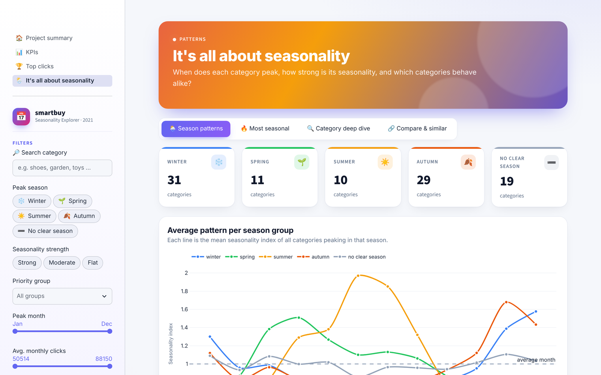

# 📅 smartbuy: Category Seasonality Dashboard

**An interactive Streamlit app that measures how seasonal 100 e-commerce product categories are, when they peak, and which ones to plan campaigns for first.**




## 🎯 The problem

The Content Department of **smartbuy**, an online shop, decided which product categories were seasonal by **looking at charts manually**. That was slow, subjective and hard to repeat.

We turned this into a **measurable, repeatable analysis** and a **self-service web app**, so the team can explore the results themselves instead of waiting for a slide deck.

## 🔑 Key findings

1. **November is the busiest month** (10.6 % of all clicks); **February is the quietest** (7.2 %).
2. **November is also the most common peak month**: 34 categories peak there, and 48 seasonal categories peak between September and December.
3. **Winter (31) and autumn (29) peakers dominate**, far ahead of spring (11) and summer (10). 19 categories have no clear season.
4. **37 of 100 categories are strongly seasonal.**
5. The most seasonal category is **ski & snowboard helmets**: it peaks in January with **21× the clicks** of its lowest month.
6. **25 categories are both big and seasonal**, so they have the biggest upside for campaign planning.

## 💡 Recommendations

- Use the **seasonality score** instead of eyeballing charts: above 1.0 means strongly seasonal.
- **Start campaigns 4–6 weeks before** a category's peak month, especially before the Q4 peak.
- **Prioritise the "big & seasonal" group** first.
- Use **flat categories** as steady, all-year traffic drivers.

## 📊 Method

| Step | What we did |
|---|---|
| **Combine** | Stacked 100 CSV files (one per category) into one table: 100 categories × 12 months |
| **Clean** | Filled missing months from neighbouring months, treating December and January as neighbours |
| **Normalise** | Divided each month by the category's average (1.0 = an average month), so big and small categories are comparable |
| **Measure** | Seasonality score (max − min of the index), peak and lowest month, peak-to-low ratio |
| **Classify** | Strength (*flat / moderate / strong*), peak season, and priority groups by size × seasonality |
| **Compare** | Similar categories found by correlating their 12-month patterns |

## 🖥️ The app

| KPIs | Top clicks |
|---|---|
|  |  |



- **Project summary**: the challenge, the solution and headline numbers
- **KPIs**: busiest months, a priority matrix (size vs. seasonality) and a sortable priority list
- **Top clicks**: the top-n categories by traffic, with n chosen by a slider
- **It's all about seasonality**: season patterns, the most seasonal categories, a single-category deep dive and similar categories
- **Shared sidebar filters** on every data page: search, peak season, strength, priority group, peak month and click range

## ▶️ Run it locally

```bash
git clone https://github.com/majid-vazifeh-amandi/smartbuy-seasonality-dashboard.git
cd smartbuy-seasonality-dashboard
pip install -r requirements.txt
streamlit run app.py
```

The first version of the app is kept in `app_v1/` and runs with `streamlit run app_v1/Overview.py`.

## 📁 Project structure

```
├── app.py              # entry point: navigation and shared sidebar filters
├── ui.py               # design system: theme, cards, chart styling, filters
├── utils.py            # data loading and all KPI calculations
├── views/              # the four app pages
├── app_v1/             # first version of the app
├── data/               # 100 category files + combined_categories.csv
├── notebooks/
│   ├── 01_exploration.ipynb           # combining the data and first EDA
│   ├── 02_seasonality_analysis.ipynb  # KPIs, charts, findings and recommendations
│   └── 03_app_production.ipynb        # how the web app was built
└── assets/             # screenshots
```

## 👥 Team & my role

Built as a 4-person group project in the **Data Analytics bootcamp** (module: AI-Enhanced Data Analytics).

- **Majid Vazifeh Amandi**: data preparation, KPI design and the first version of the app (`app_v1/`)
- Lorenz Schneider
- Carlos Musetti
- Prasad Natuskar

The final version of the app was developed further by the team.

## 🤖 Use of AI

Claude (Claude.ai and Claude Code) was used as an assistant for planning, analysis and code. All AI-generated code and results were reviewed and checked against the actual data.
